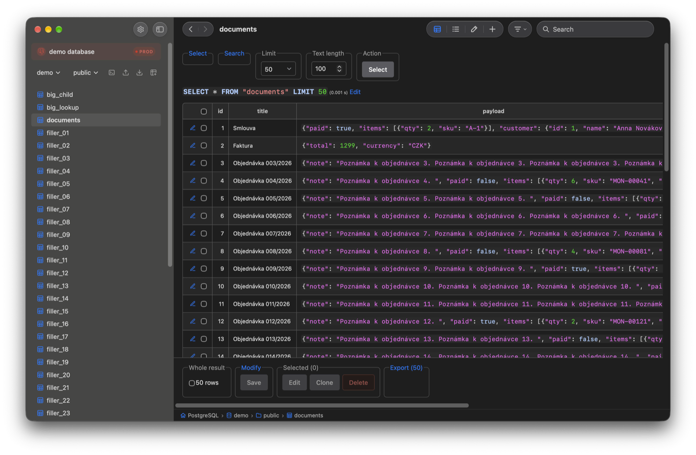

<h1 align="center">
    
    Adminer Desktop
</h1>

<h3 align="center">
    Download it, open it, connect to your favourite database, and start working.
</h3>

    

----

> Adminer itself is not modified or forked. This app runs the official [Adminer](https://www.adminer.org) release in a
native desktop window and adds a few desktop-friendly improvements around it. Not affiliated
with the Adminer project.

---

## What it adds

### A desktop app

- Install it like any other app. No PHP, no web server, no browser.
- On macOS the window is laid out like Mail and Finder: no title bar, the sidebar in the system's material.
- Stays logged in between launches.
- Works well with Docker. Sensible defaults make connecting to containerized databases easier.
- Exports download as files, with progress.
- Desktop navigation with Back/Forward buttons, trackpad gestures, Cmd/Ctrl+R, and F5.

### Connections you can tell apart

- Saved connections open as named cards, each with an environment (LOCAL, DEV, STAGE, PROD) and a colour.
- Inside a connection its colour and name stay in sight, so a production window cannot pass for a local one.
- Destructive buttons are red and ask for confirmation first.

### Getting around faster

- Press Shift twice to search for a table from any page.
- Press ? to list every keyboard shortcut, in your platform's notation.
- Type to filter a long select, such as the database or schema picker.
- Double-click a table to open its data.
- Browse tables without losing your place in the sidebar.
- An activity indicator shows while a page, a table or a long SQL command loads.

### Working with data

- Resizable table columns, and long comments wrap instead of widening the table.
- Sorting and resizing refresh the rows in place, without the page rebuilding itself.
- Larger edit forms that remember your layout.
- Drag and drop `.sql` files onto the import page.

### Settings in one place

- Available before you connect.
- Light and dark mode, with themes for both.
- Language, scaling, row density, and plugins. Your plugin selection is remembered.
- Resizable sidebar that remembers its width.
- Reset everything back to the default settings with one click.

### MCP server 

- Let Claude, Codex or another agent query your saved connections, read-only or with writes, as you choose.
- The agent can pick the connection and database itself, not only the one the window is on.
- Writes need a switch of their own, and never reach a connection tagged PROD.
- A superuser login is refused outright, since it could escape a read-only query.

## Documentation

- **[Installing](.docs/install.md)** — macOS, Debian/Ubuntu, which platforms work, and where
  it keeps your settings.
- **[MCP Server](.docs/mcp.md)** — turning it on, and letting Claude or Codex read or write your database, as you choose.
- **[Developing](.docs/development.md)** — building it yourself, the checks, what is pinned.
- **[Linux releases](.docs/releases-linux.md)** — why there is a `.deb` and no apt repository.

## Licence

[Adminer](https://github.com/vrana/adminer) is Apache-2.0 / GPL-2.0. This wrapper is MIT. The Adminer logo, used as the app icon,
belongs to the Adminer project.
